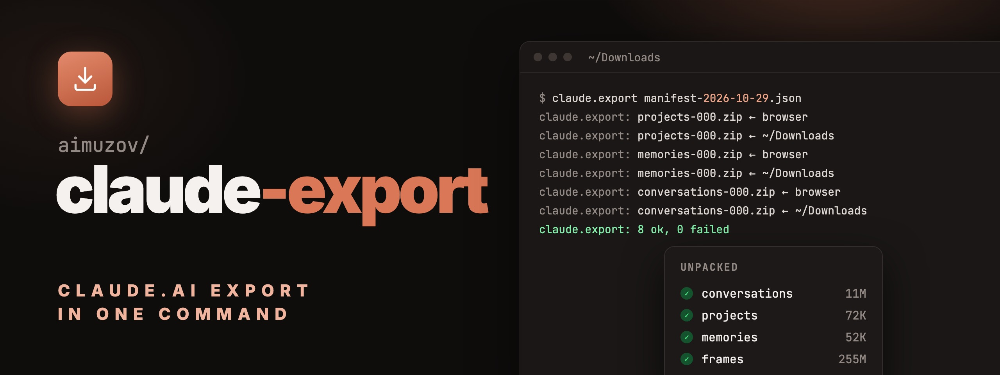

<p align="center">
	
	<a href="README.ru.md"></a>
</p>

<p align="center">
	<a href="https://github.com/aimuzov/claude-export"></a>
</p>

<p align="center">
	<a href="https://github.com/aimuzov/claude-export/actions/workflows/ci.yml"></a>
	<a href="LICENSE"></a>
</p>

<h3 align="center">Your claude.ai data export, unpacked in one command</h3>
<p align="center">Give it the manifest, and it downloads every archive through your browser, checks it and unpacks it by category</p>

```sh
claude.export ~/Downloads/manifest-….json
```

## Why

claude.ai sends the export as a small JSON manifest with a link per archive. The links live for
24 hours, may work only once and sit behind a Cloudflare check that `curl` can't pass. So you end
up clicking eight links, waiting for each download and unpacking eight zips by hand, and one stray
click on a used link means asking for a new export.

`claude.export` does that round for you. It opens each link in your default browser, which passes
the check and is already signed in, waits until the download finishes and unpacks it. A link that
opens an error page instead of a download is reported within 30 seconds, not after a timeout.

## fish and sh

The command is `claude.export` in every shell. It comes in two implementations that behave the
same and pass the same tests: [`functions/claude.export.fish`](functions/claude.export.fish) for fish
and [`bin/claude.export`](bin/claude.export) in POSIX `sh` for the rest. In fish the function wins
over the file in `PATH`, so having both installed does no harm.

## Requirements

- macOS or Linux
- [fish](https://fishshell.com) 4.0 or newer for the function, any POSIX `sh` for `bin/claude.export`
- [jq](https://jqlang.github.io/jq/), `unzip`, `find`
- a browser that saves downloads to a known folder

## Install

### fish

With [fisher](https://github.com/jorgebucaran/fisher):

```fish
fisher install aimuzov/claude-export
```

With [chezmoi](https://www.chezmoi.io/), in `.chezmoiexternal.toml`:

```toml
[".config/fish/functions/claude-export"]
type = "archive"
url = "https://github.com/aimuzov/claude-export/archive/main.tar.gz"
exact = true
stripComponents = 2
refreshPeriod = "168h"
include = ["*/functions/**"]

[".config/fish/completions/claude-export"]
type = "archive"
url = "https://github.com/aimuzov/claude-export/archive/main.tar.gz"
exact = true
stripComponents = 2
refreshPeriod = "168h"
include = ["*/completions/claude.export.fish"]
```

fish does not look into subfolders of `functions/` and `completions/` by itself, so add them to
`fish_function_path` and `fish_complete_path`, or drop the folder level from the targets.

### Any other shell

The CLI is a single file:

```sh
curl -fsSL https://raw.githubusercontent.com/aimuzov/claude-export/main/bin/claude.export \
	-o ~/.local/bin/claude.export && chmod +x ~/.local/bin/claude.export
```

## Usage

1. On claude.ai open Settings → Privacy → Export data and wait for the email.
2. Download the manifest from the email. Don't open the archive links yourself: each may work only
   once.
3. Run:

```sh
claude.export [options] <manifest.json> [dest_root]
```

| Option | Meaning |
| --- | --- |
| `-f`, `--from dir` | Folder the browser saves downloads to, repeatable. Default: the manifest's folder and `~/Downloads` |
| `-t`, `--timeout seconds` | How long to wait for each download. Default: 300 |
| `dest_root` | Where backups go. Default: `$CLAUDE_EXPORT_DEST` or `~/claude-export` |
| `-h`, `--help` | Show help |
| `-V`, `--version` | Show the version |

The result lands in `dest_root/<created_at>/`:

```
2026-10-29T08-57-58/
├── manifest.json        copy of the manifest
├── zips/                the archives as downloaded
├── conversations/       conversations.json
├── projects/
├── memories/
└── …                    one folder per category
```

## How it behaves

- **Archives already on disk are used as they are.** If the browser has already saved a zip, it is
  taken without opening the link. A zip older than the export's `created_at` is skipped: every
  export names its archives the same, and a leftover from last month would pass for this one.
- **A repeated download** saved as `name (1).zip` is found too, the newest one wins.
- **A used or expired link** opens an error page and no download starts. If no partial file
  (`.crdownload`, `.download` or `.part`) shows up within 30 seconds, the archive is reported and the
  rest go on.
- **One failure does not stop the rest**, since the links may die once opened. At the end you get
  a summary and exit code 1 if anything failed.
- **Reruns are safe.** Archives already in the backup are skipped, so you can download the missing
  ones by hand and run it again.

| Variable | Meaning |
| --- | --- |
| `CLAUDE_EXPORT_DEST` | Default `dest_root` |
| `CLAUDE_EXPORT_OPEN` | Command that opens a URL. Default: `open` on macOS, `xdg-open` elsewhere |

## Development

```sh
sh tests/run.sh sh     # bin/claude.export
sh tests/run.sh fish   # functions/claude.export.fish
shellcheck -s sh bin/claude.export tests/run.sh
```

The same cases run against both implementations, with fake manifests and a fake browser set
through `CLAUDE_EXPORT_OPEN`. A fix in one of them goes into the other in the same commit.

## License

[MIT](LICENSE)
