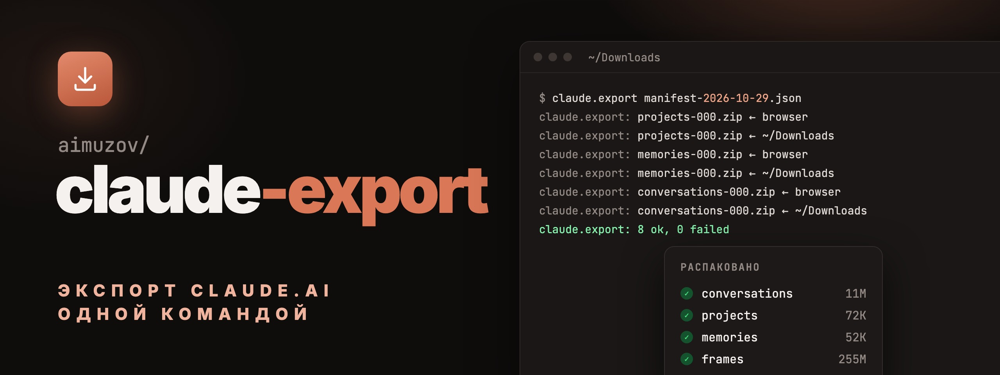

<p align="center">
	<a href="README.md"></a>
	
</p>

<p align="center">
	<a href="https://github.com/aimuzov/claude-export"></a>
</p>

<p align="center">
	<a href="https://github.com/aimuzov/claude-export/actions/workflows/ci.yml"></a>
	<a href="LICENSE"></a>
</p>

<h3 align="center">Экспорт данных claude.ai, распакованный одной командой</h3>
<p align="center">Даёшь манифест, а он скачивает через браузер каждый архив, проверяет его и раскладывает по категориям</p>

```sh
claude.export ~/Downloads/manifest-….json
```

## Зачем

claude.ai присылает экспорт как маленький JSON-манифест со ссылкой на каждый архив. Ссылки живут
24 часа, могут сработать только один раз и закрыты проверкой Cloudflare, через которую `curl` не
проходит. В итоге кликаешь восемь ссылок, ждёшь каждую загрузку и руками распаковываешь восемь zip,
а один лишний клик по уже использованной ссылке означает новый запрос экспорта.

`claude.export` делает этот круг за тебя. Он открывает каждую ссылку в браузере по умолчанию,
который проходит проверку и уже залогинен, ждёт конца загрузки и распаковывает архив. Ссылку,
которая вместо загрузки открыла страницу с ошибкой, он отметит за 30 секунд, а не по таймауту.

## fish и sh

Команда в любом shell называется `claude.export`. У неё две реализации, которые ведут себя
одинаково и проходят одни и те же тесты: [`functions/claude.export.fish`](functions/claude.export.fish)
для fish и [`bin/claude.export`](bin/claude.export) на POSIX `sh` для остальных. В fish функция
побеждает файл из `PATH`, так что если стоят обе, ничего не сломается.

## Что нужно

- macOS или Linux
- [fish](https://fishshell.com) 4.0 или новее для функции, любой POSIX `sh` для `bin/claude.export`
- [jq](https://jqlang.github.io/jq/), `unzip`, `find`
- браузер, который сохраняет загрузки в известную папку

## Установка

### fish

Через [fisher](https://github.com/jorgebucaran/fisher):

```fish
fisher install aimuzov/claude-export
```

Через [chezmoi](https://www.chezmoi.io/), в `.chezmoiexternal.toml`:

```toml
[".config/fish/functions/claude-export"]
type = "archive"
url = "https://github.com/aimuzov/claude-export/archive/main.tar.gz"
exact = true
stripComponents = 2
refreshPeriod = "168h"
include = ["*/functions/**"]

[".config/fish/completions/claude-export"]
type = "archive"
url = "https://github.com/aimuzov/claude-export/archive/main.tar.gz"
exact = true
stripComponents = 2
refreshPeriod = "168h"
include = ["*/completions/claude.export.fish"]
```

fish сам не заглядывает в подпапки `functions/` и `completions/`, так что добавь их в
`fish_function_path` и `fish_complete_path` или убери уровень папки из целей.

### Любой другой shell

CLI -- это один файл:

```sh
curl -fsSL https://raw.githubusercontent.com/aimuzov/claude-export/main/bin/claude.export \
	-o ~/.local/bin/claude.export && chmod +x ~/.local/bin/claude.export
```

## Как пользоваться

1. На claude.ai открой Settings → Privacy → Export data и дождись письма.
2. Скачай из письма манифест. Ссылки на архивы сам не открывай: каждая может сработать только раз.
3. Запусти:

```sh
claude.export [options] <manifest.json> [dest_root]
```

| Опция | Что значит |
| --- | --- |
| `-f`, `--from dir` | Папка, куда браузер сохраняет загрузки, можно несколько. По умолчанию папка манифеста и `~/Downloads` |
| `-t`, `--timeout seconds` | Сколько ждать каждую загрузку. По умолчанию 300 |
| `dest_root` | Куда класть бэкапы. По умолчанию `$CLAUDE_EXPORT_DEST` или `~/claude-export` |
| `-h`, `--help` | Показать справку |
| `-V`, `--version` | Показать версию |

Результат окажется в `dest_root/<created_at>/`:

```
2026-10-29T08-57-58/
├── manifest.json        копия манифеста
├── zips/                архивы как скачались
├── conversations/       conversations.json
├── projects/
├── memories/
└── …                    по папке на категорию
```

## Как он себя ведёт

- **Архивы, которые уже на диске, берутся как есть.** Если браузер уже сохранил zip, ссылка не
  открывается. Zip старше `created_at` экспорта пропускается: в каждом экспорте архивы называются
  одинаково, и остаток с прошлого месяца сошёл бы за этот.
- **Повторная загрузка** с именем `name (1).zip` тоже находится, берётся самая свежая.
- **Использованная или истёкшая ссылка** открывает страницу с ошибкой, и загрузка не начинается.
  Если за 30 секунд не появился незаконченный файл (`.crdownload`, `.download` или `.part`), архив
  отмечается как ошибка, а остальные качаются дальше.
- **Одна ошибка не останавливает остальные**, потому что ссылки могут умереть после открытия. В
  конце -- сводка и код выхода 1, если что-то не скачалось.
- **Перезапуск безопасен.** Архивы, которые уже в бэкапе, пропускаются, так что можно докачать
  недостающие руками и запустить снова.

| Переменная | Что значит |
| --- | --- |
| `CLAUDE_EXPORT_DEST` | `dest_root` по умолчанию |
| `CLAUDE_EXPORT_OPEN` | Команда, которая открывает URL. По умолчанию `open` на macOS, `xdg-open` в остальных |

## Разработка

```sh
sh tests/run.sh sh     # bin/claude.export
sh tests/run.sh fish   # functions/claude.export.fish
shellcheck -s sh bin/claude.export tests/run.sh
```

Одни и те же проверки гоняются на обеих реализациях, с фейковыми манифестами и фейковым браузером
через `CLAUDE_EXPORT_OPEN`. Исправление в одной из них идёт в другую в том же коммите.

## Лицензия

[MIT](LICENSE)
